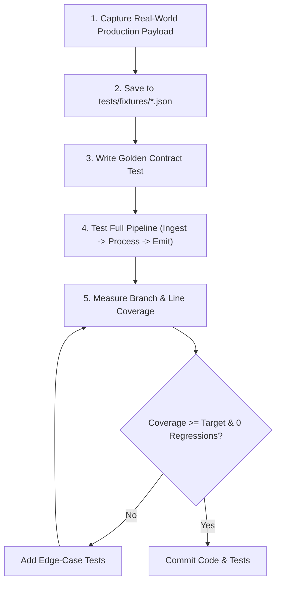

# Functional Regression Testing & Coverage Skill

This skill guides the design, implementation, and verification of **functional regression test suites** that target observable behavioral contracts rather than internal implementation details, eliminating the blind spots caused by synthetic unit mocks.

---

## 1. Core Philosophy: The Anti-Mock-Drift Principle

Unit test mocks often create a false sense of security because the developer writes the mock based on **assumptions** about how external APIs or services behave. When the real service returns a different data type (e.g., `["8000/http"]` instead of `[{"privatePort": 8000}]`), 100% of the unit tests pass while production crashes with an `AttributeError` or `KeyError`.

### Three Rules to Eliminate Mock Drift
1. **Golden Production Fixtures**: Store actual, raw JSON/SSE responses captured from real production endpoints in `tests/fixtures/<service>_<endpoint>.json`. Tests must load these verbatim files rather than defining inline `MagicMock` dictionaries.
2. **Defensive Contract Validation**: Parsers and normalizers must be tested against all schema variations:
   - `list[dict]` vs. `list[str]` vs. `str` (comma-separated)
   - `null` / `None` values where objects or lists were expected
   - Missing fields, unexpected fields, and mixed types
3. **Reproduce First, Fix Second**: Before fixing any production defect, create a regression test reproducing the exact input payload that triggered the failure. Verify that the test fails before making code changes, and passes afterward.

---

## 2. Standard Regression Workflow

Follow this procedure when creating functional regression tests:



### Step 1: Capture and Save Production Fixtures
Capture authentic payloads (sanitizing sensitive tokens/secrets) and place them under `tests/fixtures/`:
- `tests/fixtures/<provider>_<api>_response.json`
- `tests/fixtures/<provider>_<api>_error_429.json`
- `tests/fixtures/<provider>_<api>_stream_sample.sse`

### Step 2: Implement Contract & Regression Tests
In `tests/test_golden_contract.py` or domain-specific test suites:
- Load the raw fixture from disk via `json.load()`.
- Pass the fixture through the full parsing and normalization pipeline.
- Assert observable outcomes: verified endpoints, transformed domain objects, and operational state transitions.

### Step 3: Run With Coverage Analysis
Execute the test suite with line and branch coverage enabled:
```bash
# Run tests with branch coverage
python3 -m coverage run --branch -m unittest discover -s tests -p "test_*.py" -v

# Generate terminal coverage report with missing line numbers
python3 -m coverage report -m --fail-under=85
```

---

## 3. Coverage Analysis & Metrics

Coverage provides an objective metric to ensure all execution paths are exercised:

Metric | What It Measures | Target
:--- | :--- | :---
**Statement Coverage** | Whether each line of code was executed at least once | >= 90%
**Branch Coverage** | Whether both `True` and `False` branches of every `if`, `while`, and `try/except` were taken | >= 85%
**Regression Coverage** | 100% of previously discovered bugs have dedicated reproducing tests | 100%

### Checking Untested Branches
In the output of `coverage report -m`, examine the `Missing` column:
```text
Name                       Stmts   Miss Branch BrPart  Cover   Missing
----------------------------------------------------------------------
core/stt/runpod_engine.py    450     12     80      4    96%   412-415, 580->585
```
- `412-415`: Unexecuted statements (e.g., error fallback branch).
- `580->585`: Branch partition where only one direction of a conditional was tested. Add test cases specifically triggering the missing condition.

---

## 4. Reusable Test Templates

See the companion references and scripts:
- [Anti-Mock Patterns & Golden Fixtures](./references/anti_mock_patterns.md)
- [Automated Coverage Runner Script](./scripts/run_coverage.py)
