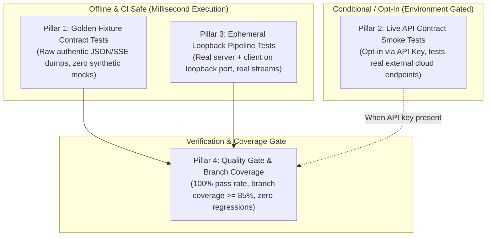

# Multi-Tiered Functional Regression Testing & Coverage Skill

This skill guides the design, implementation, and maintenance of **comprehensive, production-grade functional regression test suites**. It addresses the common failure modes of software testing—especially **Mock Drift**, **Silent Upstream API Breaks**, and **Untested Asynchronous Pipelines**—by establishing four complementary testing tiers and enforcing measurable branch coverage.

---

## The Four Pillars of Functional Regression Testing



---

## Pillar 1: Golden Production Fixtures (Anti-Mock Contract Testing)

### Why Unit Mocks Fail
When engineers write unit mocks (e.g. `mock_resp.json.return_value = {"ports": [{"privatePort": 8000}]}`), they test their **mental model** of the third-party service, not reality. When the real API returns `{"ports": ["8000/http"], "runtime": null}`, unit tests remain 100% green while production crashes with an `AttributeError` or `KeyError`.

### General Implementation Pattern
1. **Directory Structure**: Store verbatim snapshots in `tests/fixtures/<service>_<endpoint>_<scenario>.json`:
   - `tests/fixtures/service_v2_resource_active.json`
   - `tests/fixtures/service_v2_resource_empty.json`
   - `tests/fixtures/service_v2_resource_edge_types.json`
2. **Defensive Type Permutations**: Test parsers against:
   - Scalar string vs. list of strings vs. list of dictionaries.
   - `null` / `None` values where objects or lists were expected.
   - Unexpected extra fields and missing optional keys.
3. **Fixture Ingestion Test**:
   ```python
   def test_golden_contract_ingestion(self):
       with open("tests/fixtures/service_v2_resource_active.json", "r", encoding="utf-8") as f:
           raw_payload = json.load(f)
       # Feed directly into production parser / client
       result = client.parse_resource(raw_payload)
       self.assertIsNotNone(result.endpoint_url)
       self.assertEqual(result.status, "ACTIVE")
   ```

---

## Pillar 2: Live API Contract Smoke Tests (Opt-In / Conditional)

### Purpose
Detects breaking changes in upstream third-party APIs (e.g., deprecated fields, changed response schemas, rate-limit adjustments) before code reaches end users.

### General Implementation Pattern
- **Conditional Execution**: Gate tests on the presence of the live environment variable or API key so that local development and offline CI runs pass without requiring credentials or incurring cloud costs:
  - **Python (`unittest`)**: `@unittest.skipUnless(os.getenv("<SERVICE>_API_KEY"), "Live <SERVICE>_API_KEY required")`
  - **Python (`pytest`)**: `@pytest.mark.skipif(not os.getenv("<SERVICE>_API_KEY"), reason="...")`
  - **JavaScript (`Jest`)**: `const describeIfLive = process.env.API_KEY ? describe : describe.skip;`
  - **Go**: `if os.Getenv("API_KEY") == "" { t.Skip("Skipping live test") }`
- **What to Verify in Live Smoke Tests**:
  1. **Schema Integrity**: Query the live endpoint (e.g. `GET /v2/resources`) and assert that all required keys are present and have expected types.
  2. **Rate-Limit Compliance**: Verify that headers (`Retry-After`, `X-RateLimit-Remaining`) are parsed correctly.
  3. **Live Health Probe**: If active resources exist on the account, send a lightweight `GET /health` probe to verify end-to-end network routability.

```python
@unittest.skipUnless(os.getenv("SERVICE_API_KEY"), "Live SERVICE_API_KEY required for smoke test")
class TestLiveAPIContract(unittest.TestCase):
    def test_live_schema_and_endpoint_health(self):
        api_key = os.getenv("SERVICE_API_KEY")
        client = ServiceClient(api_key=api_key)
        resources = client.fetch_resources()
        self.assertIsInstance(resources, list)
        for res in resources:
            self.assertTrue(hasattr(res, "id") and len(res.id) > 0)
```

---

## Pillar 3: Ephemeral End-to-End Pipeline Smoke Tests (Real Loopback Sockets)

### Purpose
Verifies full client-server workflows without synthetic function stubs by executing actual network I/O over the local OS loopback interface (`127.0.0.1`).

### General Implementation Pattern
1. **Dynamic Ephemeral Port**: Bind the server to port `0` or an ephemeral OS port (e.g. `8800-8999`) to prevent port collisions in concurrent test runners.
2. **Real Protocol Communication**: Connect the real client using real HTTP, WebSocket, gRPC, or TCP sockets.
3. **Realistic Ingestion Stream**: Stream authentic domain chunks (e.g., PCM audio, binary event packets, streaming NDJSON) through the pipeline.
4. **Observable State Verification**: Assert:
   - Chunk reception and downstream event emissions.
   - Incremental state transitions (e.g., `in_progress` -> `finalized`).
   - Clean shutdown without unclosed resource warnings, socket leaks, or hanging event loops.

```python
class TestPipelineIntegration(unittest.TestCase):
    def setUp(self):
        # Start in-process or daemon server on ephemeral loopback port
        self.server_port = 8899
        self.server = start_local_server(port=self.server_port)

    def tearDown(self):
        self.server.stop()

    def test_end_to_end_stream_processing(self):
        client = PipelineClient(url=f"ws://127.0.0.1:{self.server_port}/stream")
        client.connect()
        client.stream_chunk(b"sample_data")
        response = client.receive_event(timeout=5.0)
        self.assertEqual(response.status, "processed")
        client.close()
```

---

## Pillar 4: Pre-Flight Verification Gate & Coverage Enforcement

### Purpose
Provides a quantitative guarantee that all critical logic, error recovery branches, and edge-cases are actively exercised before merging or deploying.

### General Implementation Pattern
1. **Measure Branch & Line Coverage**:
   Use standard coverage tools configured to track branches:
   - **Python**: `python3 -m coverage run --branch -m unittest discover -s tests -p "test_*.py" -v`
   - **Node.js**: `jest --coverage --coverageReporters="text" --coverageThreshold='{"global":{"branches":85}}'`
   - **Go**: `go test -coverprofile=coverage.out ./... && go tool cover -func=coverage.out`
2. **Coverage Thresholds**:
   - **Statement Coverage**: >= 90% on business and networking logic.
   - **Branch Coverage**: >= 85% across all conditional evaluations (`if/else`, `try/except`, `while`).
   - **Regression Coverage**: 100% of previously resolved production defects must have an explicit, reproducing test.
3. **Inspecting Missing Branches**:
   Review the coverage report's missing line annotations:
   - Ensure rate-limit backoff paths (`HTTP 429`), network disconnection handlers, and fallback routes are tested.

---

## Standard Runbook for New Features & Bug Fixes

When implementing new features or fixing defects:

1. **Bug Reproduction**: Create a failing test in the appropriate tier reproducing the defect using the exact payload or event sequence that triggered the bug.
2. **Fixture Capture**: If the bug was caused by an unexpected external API payload, store the authentic payload in `tests/fixtures/`.
3. **Implementation**: Fix the defect in code with defensive type handling.
4. **Verification Gate**: Execute the full test suite and coverage runner:
   ```bash
   python3 .agents/skills/functional-regression-testing/scripts/run_coverage.py 85
   ```
5. **Confirmation**: Ensure 100% of tests pass across all tiers with zero regressions.

---

## 5. Autonomous Agent Enforcement (Zero User Burden)

This skill is designed specifically to relieve the human user of **all** testing and maintenance burdens:

1. **Zero User Execution**:
   - The AI agent MUST NEVER ask the user to run `unittest`, `pytest`, coverage scripts, or test commands.
   - The AI agent autonomously executes the test runner via tool calls before reporting completion. A task is strictly not done until the agent observes 100% passing tests.
2. **Zero User Maintenance**:
   - The user never writes mocks, asserts schemas, or edits test files.
   - Whenever the agent modifies an API client, refactors a parser, or resolves a production defect, the agent **autonomously captures the new fixture, updates the corresponding tests, and verifies coverage** in the exact same commit.
3. **Self-Healing Test Suites**:
   - When external API contracts evolve, the agent is responsible for capturing the new production payload into `tests/fixtures/` and adapting the contract tests so the test suite maintains itself over time.

